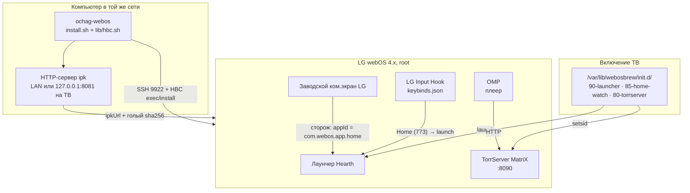

# ОЧАГ (ochag-webos) — тихий домашний экран и торрент-стек на телевизоре LG под webOS 4.x

> **Root-нутый LG: вместо заводских баннеров и «рекомендаций» — часы, погода и ряд своих приложений;
> вместо приставки — TorrServer прямо на панели и плеер OMP по его каталогу.**
> Всё собрано из открытых проектов, но с обвязкой, которой в них нет: установка по неочевидному
> контракту HBC, демонизация торрент-сервера в обход проверки подписи, перехват кнопки Home.
> 12 грабель прошивки разобраны в [`docs/FIRMWARE-POSTMORTEM.md`](docs/FIRMWARE-POSTMORTEM.md).

**Проверено на живой панели: LG 43UN71006LB (2019), webOS 4.5.0, Homebrew Channel 0.6.3, root.**


[](https://github.com/Bezooom/ochag-webos/actions/workflows/ci.yml)
[](https://github.com/Bezooom/ochag-webos/actions/workflows/ci.yml)
[](LICENSE)

---

## 🖥️ Что получается на телевизоре

| Узел | Что даёт | Как проверено |
| :--- | :--- | :--- |
| **Лаунчер Hearth** (`tld.my.customlauncher`) | часы, дата и погода, ряд приложений и входов, OLED-чёрный фон или свои обои; настройки целиком с пульта | `getForegroundAppInfo → tld.my.customlauncher` |
| **Кнопка Home** | открывает лаунчер, а не заводской экран: LG Input Hook (`keybinds.json`) + root-сторож на случай промаха | `keybinds.json` + `Keybinds reloaded due to config file change` |
| **Автозапуск** | ТВ включается сразу в лаунчер, без «умного» экрана LG | хук `/var/lib/webosbrew/init.d/90-launcher` |
| **Торренты на панели** | TorrServer MatriX демоном на `:8090`: каталог, раздачи, веб-морда с любого устройства в сети | `curl :8090/echo → MatrIX.142.2`, `POST /torrents → []` |
| **Плеер OMP** (`com.spacesarmat.torrplayer`) | каталог TorrServer, сезоны, дорожки, аппаратный декодер LG — привычный сценарий «как Num» | установлен и запущен, `foreground` подтверждён |
| **RU-медиа** | Кинопоиск, Иви, Wink, Okko, PREMIER, START, RUTUBE, VK, Смотрёшка, Яндекс, Первый, КИОН | id и источники — [ниже](#-ru-медиа-id-приложений) |
| **YouTube без рекламы** | `youtube.leanback.v4` из репозитория webosbrew | установлен, в работе |

Всё, что делает кит, идемпотентно: повторный прогон ничего не ломает и не трогает системные приложения.

---

## 🧩 Как это устроено



Ключевое решение: **торрент-сервер здесь демон, а не приложение**. GUI-пакет `com.torrserver.app`
на этой прошивке не проходит проверку подписи, а его Luna-сервис без установки не регистрируется.
Кит берёт из пакета бинарь `TorrServer`, кладёт в `/media/developer/torrserver` и поднимает
через `init.d` — функциональность та же, веб-морда и API на месте.

---

## 🔬 Грабли, которых нет в апстримах

Полный разбор с командами — [`docs/FIRMWARE-POSTMORTEM.md`](docs/FIRMWARE-POSTMORTEM.md).
Коротко, то, что ломает установку у всех:

1. **Установщик HBC берёт только `http(s)`** и **голый sha256** — с префиксом `sha256:` приходит `Invalid file checksum`.
2. **Скорость установщика ~1 КБ/с** по LAN, при этом `wget` с того же ТВ отдаёт те же файлы за <1 с → ipk раздаётся локальным сервером **на самом ТВ**, и 23 МБ перестают быть проблемой.
3. **Неподписанные пакеты** отваливаются на `-5: ipk verified failed` даже при совпавшем хеше; руками распакованный каталог работает только для **уже зарегистрированных** приложений.
4. **Dev Mode истекает** → `Unknown method "install" for category "/dev"`, а `ares-novacom --getkey` врёт про «Failed to get ssh private key».
5. **Ключ Dev Mode — зашифрованный PEM** на `http://<TV>:9991/webos_rsa`, пароль — 6-значный код с экрана.
6. **`luna-send-pub` без TTY молчит**, а `getForegroundAppInfo` для `prisoner` закрыт — только root-сессия.

---

## 📂 Структура репозитория

```text
ochag-webos/
├── README.md                  # этот файл: что ставится, как устроено, как запускать
├── LICENSE                    # MIT
├── Makefile                   # make check | test | hearth | torrserver | omp | youtube | verify
├── install.sh                 # диспетчер шагов, идемпотентный
├── lib/
│   └── hbc.sh                 # транспорт: SSH 9922, HBC exec через файл, установка ipk,
│                              #   выбор транспорта по размеру, локальный node-сервер на ТВ
├── hooks/
│   ├── 90-launcher            # запуск лаунчера при включении ТВ
│   ├── 85-home-watch          # сторож: LG Home вышел вперёд → открыть лаунчер
│   └── 80-torrserver          # автозапуск TorrServer демоном
├── tools/
│   └── torrserver-headless.sh # ar → data.tar.gz → бинарь; install/start/stop/status/uninstall
├── tests/
│   └── run.sh                 # 13 контрактных проверок без телевизора (ssh подменён фейком)
└── docs/
    ├── VERIFICATION.md        # стенд, сырые логи приёмки, хронология
    └── FIRMWARE-POSTMORTEM.md # 12 механизмов прошивки: почему ломается и чем лечится
```

---

## 🚀 Быстрый старт

Нужен root на ТВ (Homebrew Channel) и SSH-доступ на `9922`; на компьютере — `ssh`, `curl`, `node`.

```bash
git clone https://github.com/Bezooom/ochag-webos && cd ochag-webos
export TV=192.168.1.103 KEY=~/.ssh/lgtv_webos

make check                  # синтаксис + shellcheck, телевизор не нужен
make hearth                 # Hearth + Input Hook + автозапуск + перехват Home
make torrserver             # TorrServer MatriX демоном на :8090
make omp                    # плеер OMP
make youtube                # ad-free YouTube
make verify                 # матрица приёмки по живому ТВ (read-only)
```

`make verify` на живой панели:

```text
== root:        0
== init.d:      47-launcher-takeover 50-lifesgoodwithoutspying 80-torrserver
                85-hearth-home-watch 90-launcher inputhook
== apps:        com.razagr.stremio com.spacesarmat.torrplayer
                ooo.lew.lifesgoodwithoutspying org.webosbrew.hbchannel
                org.webosbrew.inputhook org.webosbrew.safeupdate
                tld.my.customlauncher youtube.leanback.v4
== foreground:  youtube.leanback.v4
== torrserver:  MatrIX.142.2
```

Контрактные тесты (без железа):

```text
$ make test
  PASS  90-launcher подставил id приложения
  PASS  80-torrserver подставил путь и порт
  PASS  ipk_hash = голый sha256
  PASS  маленький ipk → HTTP с компьютера
  PASS  большой ipk → сервер на самом ТВ
  PASS  keybinds.json разбирается и указывает на лаунчер
  ...
13 passed, 0 failed
```

---

## 🎛️ Что остаётся человеку

Два места, где API наружу не публикуется:

| Где | Что нажать | Зачем |
| :--- | :--- | :--- |
| **Hearth → Settings → Options** | `Add the launcher as a TV input` | ТВ включается в лаунчер без мигания LG-заставки |
| **Hearth → Settings → Options** | `Replace LG Home with a helper script` (или «script and SAM») | Home/Back ведут в лаунчер; после включения этого метода наш `85-home-watch` становится страховкой |
| **OMP → Настройки → сервер** | `Найти в сети` или `<TV-IP>:8090` | связать плеер с сервером |
| **LG Input Hook** | проверить ID кнопки Home в логах | `773` верен для тестового пульта; на другом пульте ID берётся из `/tmp/lginput-hook-*.log` |

---

## 📺 RU-медиа: id приложений

Нужны для `keybinds.json`, списков исключений и своих скриптов. Контента здесь нет — только идентификаторы.

| ID | Приложение | | ID | Приложение |
| :--- | :--- | :--- | :--- | :--- |
| `com.685631.3411` | Кинопоиск | | `tv.lfstrm.smotreshka` | Смотрёшка |
| `ivi` | Иви | | `ru.yandex.tvapp` | Яндекс |
| `ru.rt.video.app.tv` | Wink | | `channelone` | Первый |
| `yota.play` | Okko | | `com.huawei.app.webos.mts.tv.production` | КИОН / МТС |
| `tntwebapp` | PREMIER | | `com.razagr.stremio` | Stremio (+ Torrentio) |
| `start` | START | | `de.benzac.msx` | Media Station X |
| `rutube` | RUTUBE | | `youtube.leanback.v4` | YouTube без рекламы |
| `vkvideo` | VK Видео | | `com.spacesarmat.torrplayer` | OMP (плеер по TorrServer) |

Мусор этой прошивки (`com.webos.exampleapp.*` ×11, `store-demo`, `sync-demo`, `dangbei-*`,
`com.lgshop.app79`, `airplay`, `google.assistant`) кит не удаляет по именам — он просто не показывает
его в лаунчере, потому что список на другой модели будет другим.

---

## ⚖️ Юридическая чистота и источники

Кит ничего не содержит из чужих проектов: он их **ставит** и знает их неочевидные места.
Бинарники не распространяются — только ссылки на релизы и их sha256.

| Проект | Что взято | Лицензия | Ссылка |
| :--- | :--- | :--- | :--- |
| **Hearth** | домашний экран, его методы замены Home и TV-входа | MIT | [rudra-avatar/Hearth](https://github.com/rudra-avatar/Hearth) |
| **LG Input Hook** | перехват кнопки Home и формат `keybinds.json` | MIT | [Simon34545/lginputhook](https://github.com/Simon34545/lginputhook) |
| **OMP** | плеер каталога TorrServer | GPL-3.0 | [spacesarmat/omp](https://github.com/spacesarmat/omp) |
| **TorrServer** | бинарь MatrIX (Go, ARMv7), запускается демоном | GPL-3.0 | [YouROK/TorrServer](https://github.com/YouROK/TorrServer) |
| **torrserver-webos** | упаковка, из которой берётся бинарь (GUI не используется) | MIT | [6ebeng/torrserver-webos](https://github.com/6ebeng/torrserver-webos) |
| **Homebrew Channel** | root, `exec`/`install`, `init.d` | MIT | [webosbrew](https://github.com/webosbrew/webos-homebrew-channel) |
| **safeupdate**, **ad-free YouTube** | заморозка прошивки, пакет `youtube.leanback.v4` | см. репозиторий | [repo.webosbrew.org](https://repo.webosbrew.org/) |

- ❌ **Нет чужих бинарников и ipk** в репозитории.
- ❌ **Нет ключей, IP и кодов Dev Mode**.
- ❌ **Нет плейлистов, магнет-ссылок и API-ключей**.
- ✔️ **Всё наше** — `lib/hbc.sh` (транспорт и выбор способа установки), шаблоны `hooks/*`,
  `tools/torrserver-headless.sh`, 12 разобранных механизмов прошивки, контрактные тесты.

Вдохновение: [jakubkralka](https://x.com/jakubkralka/status/2112432879439651323) («свой лаунчер вместо
заводского экрана LG»), [cleanyour.tv](https://cleanyour.tv/) (деблоат без перепрошивки),
[partridgeworks/webos-launcher](https://github.com/partridgeworks/webos-launcher) (скелет, на котором вырос Hearth).

---

## Ограничения (честно)

- Проверено на **одной** панели и **одной** прошивке (43UN71006LB, webOS 4.5.0). webOS 3.x/6.x/7.x/11 — не проверялись.
- Сценарии требуют root: без Homebrew Channel работает только Dev Mode и только 1000 часов.
- Кит не скачивает ничего из p2p: он поднимает сервер и плеер, содержимое — решение пользователя.
- Автоматизации двух галочек в Hearth и адреса в OMP нет: их API наружу не публикуют.

## Лицензия

MIT © 2026 Pavel Naumov. Товарные знаки LG, webOS, Hearth, OMP, TorrServer принадлежат их владельцам;
проект не связан с LG Electronics.
